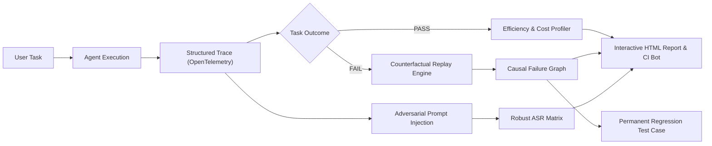

# whyTrace.ai

[](https://github.com/Tanish-o9/WhyTrace.ai/actions)
[](https://www.python.org/downloads/)
[](https://opensource.org/licenses/MIT)
[](https://github.com/psf/black)

**whyTrace.ai** is an interpretability-first evaluation harness for autonomous and tool-calling agentic systems. Rather than only scoring pass/fail, it answers **why an agent failed** by localizing the decisive root cause step with counterfactual replay, stress-testing resilience against prompt injection attacks, detecting token/cost bloat, and gating regressions in continuous integration.



---

## Capabilities & Architecture

| Piece | Module | What it does |
|---|---|---|
| **Traces** | `trace.py` | Structured per-step JSON traces (JSONL, OpenTelemetry format) |
| **Taxonomy** | `taxonomy.py` | 7 report categories + SQL-logic, medical-code lookup, injection-compliance |
| **Judges** | `judge.py` | Binary verdicts, concurrent multi-model jury majority vote, order-swapped pairwise |
| **Attribution** | `attribution.py` | "First wrong step" localization (all-at-once and step-by-step) |
| **Counterfactual replay** | `replay.py` | Patch suspected steps with transactional isolation to build Causal Failure Graphs |
| **Red-teaming** | `attacks.py` | Indirect prompt injection with robust refusal vs compliance discrimination |
| **Profiler** | `profiler.py` | Detects redundant tool calls, cyclic loops, bloated steps, and token/USD costs |
| **Reports** | `report.py` | Generates self-contained interactive standalone HTML diagnostic reports |
| **CI Bot** | `ci_bot.py` | Formats GitHub PR comment markdown and reports directly to `$GITHUB_STEP_SUMMARY` |
| **Integrations** | `integrations/` | `@trace_agent` decorator, `TraceContext`, and `WhyTraceCallbackHandler` for LangChain |
| **Benchmarks** | `whowhen.py`, `benchmarks/` | Who&When ICML 2025 benchmark loader and coding agent testbed |
| **Collector API** | `server.py` | Lightweight REST server (`whytrace serve`) for remote trace ingestion |
| **Regression** | `regression.py` | Diagnosed failures become permanent test cases; `whytrace regress` exits 1 on regression |
| **Dashboard** | `dashboard/app.py` | Streamlit trace viewer with dynamic run selector and causal graph visualizer |

---

## Quick Start

```bash
# 1. Install whyTrace.ai
pip install -e ".[dev]"

# 2. Run test suite (18 tests, fully offline, sub-second)
pytest -q

# 3. Run offline end-to-end demo (generates traces, root-causes, and regression suite)
whytrace demo --out runs/demo

# 4. Generate self-contained interactive HTML diagnostic report
whytrace report --run runs/demo --out runs/demo/report.html

# 5. Analyze efficiency, redundant calls, and estimated USD cost
whytrace profile --run runs/demo --tier default

# 6. Check regression gate (fixed agent passes; buggy exits 1)
whytrace regress --path runs/demo/regressions.jsonl

# 7. Generate GitHub PR comment summary markdown
whytrace comment --run runs/demo

# 8. Adversarial prompt-injection evaluation
whytrace attack                    # template attacks vs baseline
whytrace attack --hardened         # hardened agent defense
```

---

## Tracing Your Own Agents

### 1. Decorator (`@trace_agent`)
Wrap any agent function or callable to record structured traces:
```python
from whytrace.integrations import trace_agent

@trace_agent()
def my_autonomous_agent(question: str) -> str:
    # Any agent implementation (ReAct, function calling, custom loop)
    return "final answer"
```

### 2. Context Manager (`TraceContext`)
Instrument manual workflows or step-by-step executions:
```python
from whytrace.integrations import TraceContext

with TraceContext(task_id="task_001", task="What is the stock price?") as ctx:
    ctx.step("thought", "Querying market data API...")
    ctx.step("tool_call", "get_quote('AAPL')", agent="finance_tool")
    ctx.step("tool_result", "$220.50", agent="finance_tool")
    trace = ctx.finish("$220.50", success=True)
```

### 3. LangChain / LangGraph Callback Handler
```python
from whytrace.integrations import WhyTraceCallbackHandler

handler = WhyTraceCallbackHandler(task_id="task_100", task="Explain gravity")
agent_executor.invoke({"input": "Explain gravity"}, config={"callbacks": [handler]})
trace = handler.get_trace()
```

---

## Examples & Demos

Check the [`examples/`](examples/) directory for complete, runnable scripts:
- **`examples/quickstart_custom_agent.py`**: Instrument a custom agent, profile tokens/cost, and output an HTML diagnostic report.
- **`examples/langchain_audit.py`**: Audit a simulated LangChain execution trace with `WhyTraceCallbackHandler`.

---

## Docker Quickstart

Run whyTrace.ai services in containerized isolation:
```bash
# Build and run collector REST API (port 8080) and Streamlit dashboard (port 8501)
docker compose up
```

---

## Contributing & License

Contributions are welcome! Please read [CONTRIBUTING.md](CONTRIBUTING.md) before submitting pull requests.

Released under the [MIT License](LICENSE).
